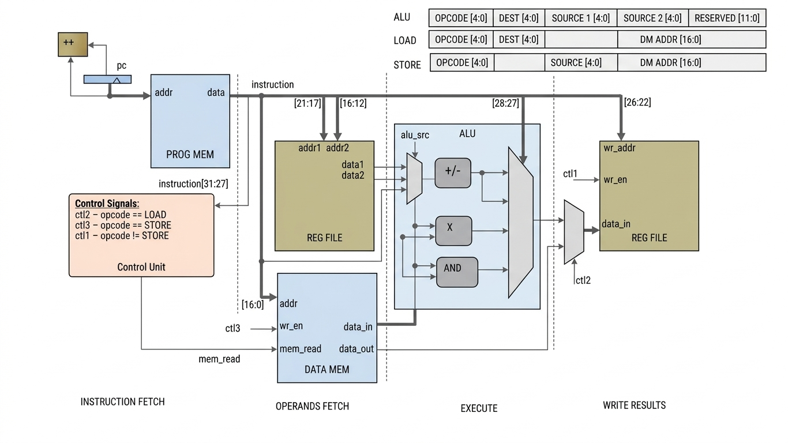
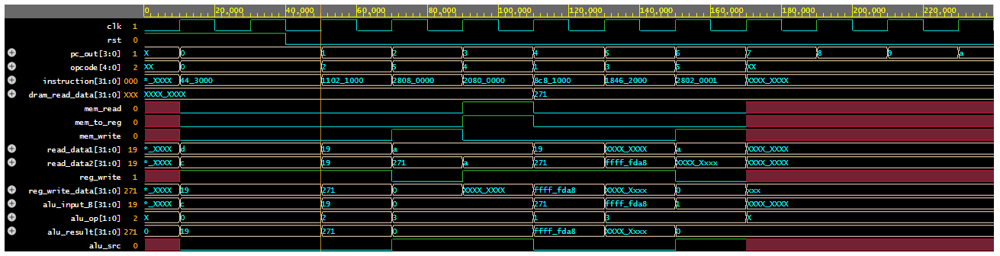
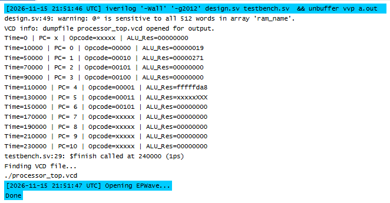

# Custom 32-bit Single-Cycle Processor with Custom ISA
A fully functional 32-bit Single-Cycle processor designed in Verilog, featuring a custom ISA, ALU, Register File, and memory modules.

## Project Overview
This project is a fully functional **32-bit Single-Cycle Processor** designed from scratch in Verilog. It utilizes a modular hierarchical design where the entire instruction execution process (Instruction Fetch, Operand Fetch, Execute, and Write-Back) is completed within a single clock cycle. 

The processor features a custom **32-bit Instruction Set Architecture (ISA)** capable of executing arithmetic, logical, and memory (Load/Store) operations. The design was rigorously verified at both the individual block level and the top-level integration using comprehensive testbenches.

## Key Features
- **Custom 32-bit ISA:** Supports R-Type (ADD, SUB, MUL, AND), I-Type (Load Word), and S-Type (Store Word) instructions.
- **Modular Datapath:** Includes a 4-bit Program Counter, Block RAM for Program/Data memory, a 32x32-bit Register File, a combinational ALU, and a dedicated Control Unit.
- **Asynchronous Read:** Register file and Program Memory reads are combinational to satisfy strict single-cycle timing constraints.
- **Complete Verification:** Individual modules are verified independently before top-level CPU integration.
- **Instruction Execution:** Successfully executes a custom 7-instruction assembly program pre-loaded via external text files (`$readmemb`/`$readmemh`).

## Architecture & Datapath
The processor operates in four sequential phases within a single clock cycle:
1. **Instruction Fetch (IF):** The Program Counter (PC) provides the address to the Program Memory (BRAM) to fetch the 32-bit instruction.
2. **Operands Fetch (OF):** The instruction is decoded by the Control Unit, and operands are fetched asynchronously from the Register File.
3. **Execute (EX):** The ALU performs the requested operation (or calculates the memory address for Load/Store).
4. **Write Results (WB):** The result is synchronously written back to the Register File or Data Memory.

## Instruction Set Architecture (ISA)
All instructions are exactly 32 bits wide.

**Instruction Formats:**
*   **R-Type (Arithmetic/Logic):** `| Opcode (5b) | Destination (5b) | Source 1 (5b) | Source 2 (5b) | Reserved (12b) |`
*   **I-Type (Load Word - LW):** `| Opcode (5b) | Destination (5b) | Not Used (5b) | Data Memory ADDR (17b) |`
*   **S-Type (Store Word - SW):** `| Opcode (5b) | Not Used (5b) | Source (5b) | Data Memory ADDR (17b) |`

**Opcode Mapping:**
| Instruction | Opcode (Binary) | Description |
| :--- | :--- | :--- |
| **ADD** | `00000` | Register 1 + Register 2 |
| **SUB** | `00001` | Register 1 - Register 2 |
| **MUL** | `00010` | Register 1 * Register 2 |
| **AND** | `00011` | Bitwise AND |
| **LW** | `00100` | Load Word from Data Memory |
| **SW** | `00101` | Store Word to Data Memory |

## Module Breakdown
The repository is structured modularly:
*   `counter_block.v`: 4-bit Program Counter (PC).
*   `program_memory.v`: Block RAM for instruction storage (initialized via `data_in_address.txt`).
*   `register_file.v`: 32x32-bit register file with two asynchronous read ports and one synchronous write port.
*   `alu.v`: Combinational Arithmetic Logic Unit.
*   `data_memory.v`: Dynamic RAM for data storage.
*   `processor_top.v`: The top-level module that instantiates and wires all components together.

## Verification & Simulation
Every module was simulated using **EDA Playground (Icarus Verilog)** and verified via EPWave. 

### Complete CPU Execution
A custom 7-instruction assembly program was loaded into the Program Memory. The simulation verifies that the PC correctly increments, and the CPU sequentially executes math operations (ADD, MUL, SUB), writes to memory (SW), and reads from memory (LW) in a single-cycle manner.

**Top-Level CPU Waveform:**

**Console Output (Instruction Execution Log):**

## 🛠️ How to Run
1. Clone the repository to your local machine.
2. Open the project in Xilinx ISE/Vivado, ModelSim, or EDA Playground.
3. Add all `.v` files from the `src/` folder to your design sources, and the testbenches from `tb/` to your simulation sources.
4. **Important:** Ensure the text files (`data_in_address.txt` and `regfile.txt` from the `test_programs/` folder) are placed in the root directory of your simulator, as the `$readmem` commands require them to initialize the memory.

## 🧑‍💻 Author
**Ali Abdullah**  
*Bachelor of Electrical Engineering (Electronics)*  
[LinkedIn](https://linkedin.com/in/aliabdullahshk) | [GitHub](https://github.com/AliAbdullahshaikh)
